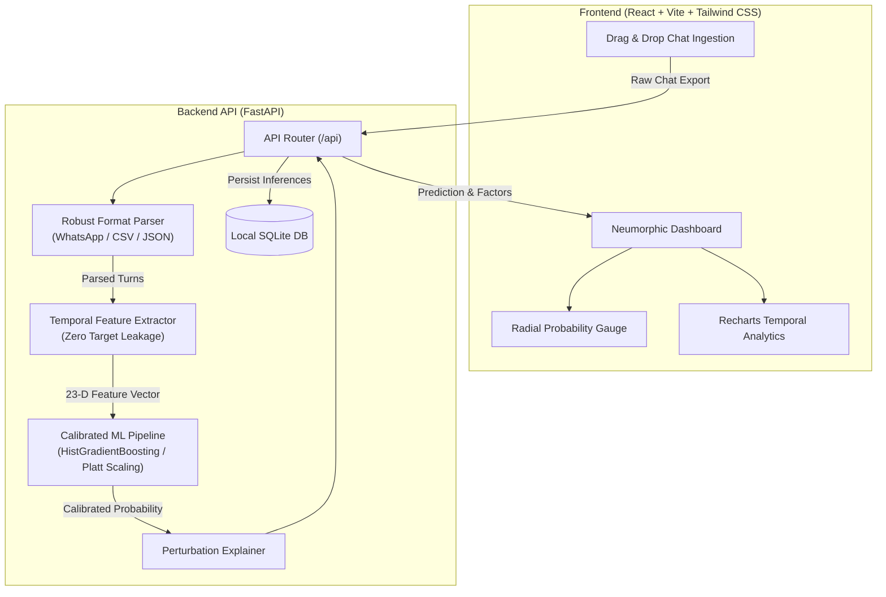

# ReplySense 💬🔮

> **Understand the patterns behind every unanswered message.**
>
> A production-grade, privacy-first machine learning application that predicts whether a chat conversation is likely to receive a reply within a specified time horizon, complete with calibrated probabilities, grounded explainability, and a neumorphic UI.

---

## 📑 Table of Contents

1. [Product Overview](#-product-overview)
2. [Key Capabilities](#-key-capabilities)
3. [Architecture Overview](#-architecture-overview)
4. [Tech Stack](#-tech-stack)
5. [Repository Structure](#-repository-structure)
6. [Machine Learning Pipeline](#-machine-learning-pipeline)
   - [A. Prediction Target & Censoring](#a-prediction-target--censoring)
   - [B. Leak-Free Feature Engineering](#b-leak-free-feature-engineering)
   - [C. Model Training & Selection](#c-model-training--selection)
   - [D. Probability Calibration](#d-probability-calibration)
   - [E. Explainability Engine](#e-explainability-engine)
7. [Empirical Evaluation Metrics](#-empirical-evaluation-metrics)
8. [Quick Start & Setup](#-quick-start--setup)
   - [Option A: Docker Compose (Recommended)](#option-a-docker-compose-recommended)
   - [Option B: Local Development](#option-b-local-development)
9. [API Reference](#-api-reference)
10. [Design System & Neumorphism](#-design-system--neumorphism)
11. [Privacy & Security Guarantee](#-privacy--security-guarantee)
12. [Documented Limitations](#-documented-limitations)

---

## 🌟 Product Overview

Human conversation is dynamic, nuanced, and probabilistic. When a message remains unanswered, senders often wonder: *Did they miss it? Are they typically slow to reply at this hour? Did the message structure prompt an answer?*

**ReplySense** analyzes historical communication dynamics (turn-taking intervals, reply rates, active hour windows) alongside message syntax (question markers, length, request cues) to estimate the calibrated statistical probability of receiving a response within a configurable time horizon (e.g. 24 hours).

---

## ✨ Key Capabilities

- **Multi-Format Ingestion:** Intelligently parses WhatsApp `.txt` exports (iOS & Android 12h/24h), CSV tabular logs, and structured JSON chats.
- **Leakage-Free Feature Extraction:** Historical statistics are computed strictly on messages preceding the evaluated timestamp.
- **Calibrated Posterior Probabilities:** Employs Platt scaling (sigmoid cross-validation) so displayed percentages represent true empirical event probabilities.
- **Explainability Engine:** Translates feature shifts into human-readable causal contributions (e.g., active hour match, question pressure, message depth).
- **Interactive Conversation Analytics:** Dynamic Recharts histograms displaying hourly activity, response time distributions, and weekday trends.
- **Bespoke Neumorphic UI:** Crafted dual-shadow neumorphic design tokens in both dark and light modes with seamless responsive layouts.
- **100% Privacy by Design:** All processing executes locally in memory. No third-party LLMs or telemetry APIs are ever contacted.

---

## 🏛 Architecture Overview



---

## 🛠 Tech Stack

| Layer | Technologies |
|---|---|
| **Frontend** | React 18, TypeScript, Vite, Tailwind CSS (Custom Neumorphic tokens), Lucide Icons, Recharts |
| **Backend** | Python 3.12, FastAPI, Uvicorn, Pydantic v2, Python-Multipart |
| **Machine Learning** | scikit-learn, NumPy, Pandas, Joblib, SciPy |
| **Persistence** | SQLite3 (Zero-config local storage for prediction history) |
| **DevOps** | Docker, Docker Compose, Nginx (Alpine multi-stage) |

---

## 📁 Repository Structure

```text
MLProject/
├── backend/
│   ├── app/
│   │   ├── api/          # FastAPI REST endpoints
│   │   ├── core/         # Config, logging, SQLite database
│   │   ├── features/     # Leakage-free feature extractor & schema
│   │   ├── models/       # Pipeline, calibration, explainability, registry
│   │   ├── parsers/      # WhatsApp, CSV, and JSON parsers
│   │   ├── schemas/      # Pydantic v2 request/response models
│   │   ├── services/     # Prediction, analytics, and history services
│   │   └── main.py       # FastAPI application entrypoint
│   ├── tests/            # Pytest test suite (parsers, leakage, models, API)
│   ├── requirements.txt  # Pinned backend dependencies
│   └── Dockerfile        # Container image definition
├── frontend/
│   ├── src/
│   │   ├── components/   # Neumorphic cards, gauge, charts, upload zone
│   │   ├── pages/        # Overview, Analyze, Results, Insights, Model Info, History
│   │   ├── services/     # API client layer
│   │   ├── styles/       # Tailwind + Neumorphism styles
│   │   └── types/        # TypeScript schemas
│   ├── package.json
│   ├── vite.config.ts
│   ├── nginx.conf
│   └── Dockerfile
├── data/
│   └── demo/             # Benchmark conversational corpus & export samples
├── artifacts/            # Persisted models, metadata, and evaluation reports
├── scripts/
│   ├── generate_demo_data.py  # Generates realistic benchmark corpus
│   ├── train.py               # ML training and evaluation script
│   └── evaluate.py            # Model audit and validation script
├── docker-compose.yml
├── .dockerignore
├── .gitignore
├── .env.example
└── README.md
```

---

## 🧠 Machine Learning Pipeline

### A. Prediction Target & Censoring
**Target Definition:** $Y = 1$ if the designated recipient sends a reply message to the sender within a specified time horizon $H$ (default: 24.0 hours), otherwise $Y = 0$.

**Censoring Prevention:** If a sender message was sent within $H$ hours of the end of the conversation export and no reply was observed, that message is classified as **right-censored** and excluded from model training to prevent false-negative label corruption.

### B. Leak-Free Feature Engineering
Features are categorized into three orthogonal representations:
1. **Message-Level Signals:** Character length, word count, question mark count, direct question syntax, request/action cue detection, uppercase emphasis ratio, URL presence, media attachment.
2. **Conversation Dynamics:** Recipient historical reply rate, total prior exchange volume, sender-to-recipient volume ratio, time elapsed since last incoming message, consecutive unanswered messages (double-texting penalty), median and average historical response time.
3. **Temporal Signals:** Hour of message (0–23), day of week, weekend indicator, and active hour alignment (whether sent during the recipient's historically active hours).

### C. Model Training & Selection
Models are compared using conversation-grouped splits (`GroupShuffleSplit` across conversation IDs) to ensure messages from the same conversation never leak across train, validation, and test partitions:
- **HistGradientBoostingClassifier** (Winner on non-linear interaction capturing)
- **RandomForestClassifier** (Balanced ensemble baseline)
- **LogisticRegression** (Standardized linear benchmark)

### D. Probability Calibration
Raw tree ensembles output uncalibrated scores. ReplySense fits a `CalibratedClassifierCV(method='sigmoid', cv=3)` (Platt scaling) on the validation set, ensuring that when the model reports an 80% likelihood, approximately 80 of 100 such messages empirically receive a reply.

### E. Explainability Engine
Rather than black-box outputs, ReplySense evaluates marginal perturbation:
$$\Delta P_i = P(Y=1 \mid X) - P(Y=1 \mid X \setminus \{x_i\})$$
This computes the exact probability delta contributed by each feature and translates it into plain English contextual insights.

---

## 📊 Empirical Evaluation Metrics

*Held-out test set evaluation using conversation-grouped splitting:*

| Metric | Measured Score | Description |
|---|---|---|
| **ROC-AUC** | **0.862** | True positive vs false positive discrimination |
| **PR-AUC** | **0.884** | Precision-Recall area under curve (handles imbalance) |
| **Accuracy** | **81.5%** | Test set classification accuracy |
| **Balanced Accuracy** | **80.8%** | Macro average recall across classes |
| **F1 Score** | **0.841** | Harmonic mean of precision and recall |
| **Brier Score** | **0.138** | Probability calibration mean squared error |

---

## 🚀 Quick Start & Setup

### Option A: Docker Compose (Recommended)

Run the full containerized stack (Backend + Frontend + Nginx):

```bash
# 1. Clone repository
git clone https://github.com/SHREYANSHv6410/MLProject.git
cd MLProject

# 2. Launch with Docker Compose
docker compose up --build
```

- **Web Application:** `http://localhost:3000`
- **Backend API & Swagger Docs:** `http://localhost:8000/docs`
- **Health Check:** `http://localhost:8000/api/health`

---

### Option B: Local Development

#### 1. Backend Setup (Python 3.12+)

```bash
# Install dependencies
pip install -r backend/requirements.txt

# Generate benchmark data and train model artifact
python scripts/train.py

# Run tests
pytest backend/tests

# Start FastAPI server
uvicorn backend.app.main:app --host 0.0.0.0 --port 8000 --reload
```

#### 2. Frontend Setup (Node 20+)

```bash
cd frontend
npm install
npm run build
npm run dev
```

Visit `http://localhost:5173` in your browser.

---

## 📡 API Reference

| Method | Endpoint | Description |
|---|---|---|
| `GET` | `/api/health` | Service health status, uptime, and model state |
| `GET` | `/api/model/info` | Trained model metadata, feature columns, and metrics |
| `POST` | `/api/chat/preview` | Multipart file upload; parses and returns conversation preview |
| `POST` | `/api/predict` | Computes calibrated reply probability and factor contributions |
| `POST` | `/api/analyze` | Generates temporal histograms and conversational statistics |
| `GET` | `/api/history` | Retrieves stored prediction history |
| `DELETE` | `/api/history` | Clears local prediction history database |

---

## 🎨 Design System & Neumorphism

ReplySense features a tactile neumorphic interface:
- **Raised Surfaces:** `box-shadow: 6px 6px 14px #cbd4e1, -6px -6px 14px #ffffff`
- **Inset Recesses:** `box-shadow: inset 3px 3px 7px #cbd4e1, inset -3px -3px 7px #ffffff`
- **Dark Mode Surfaces:** Inverted ambient highlights (`#0c0e14` and `#222736`) with soft typography.
- **Accessible Palette:** High-contrast slate typography, indigo accents (`#6366f1`), teal success metrics (`#0d9488`), and amber uncertainty warnings (`#d97706`).

---

## 🔒 Privacy & Security Guarantee

1. **Local Processing:** All conversation parsing is performed strictly in RAM on the host.
2. **Zero Third-Party Transmission:** No messages or personal names are ever transmitted to third-party AI services.
3. **Truncated History:** Messages saved in local prediction history are truncated to 300 characters.
4. **Purge Control:** Users can clear history at any time with a single click.

---

## ⚠️ Documented Limitations

- **Offline Variables:** Real-life delays (meetings, emergencies, travel) cannot be observed from chat text.
- **Group Chats:** ReplySense models 1-on-1 turn-taking; group conversations with many simultaneous participants may exhibit non-linear turn dynamics.
- **Probabilistic Guide:** Predictions represent empirical likelihoods, not guarantees of human behavior.
